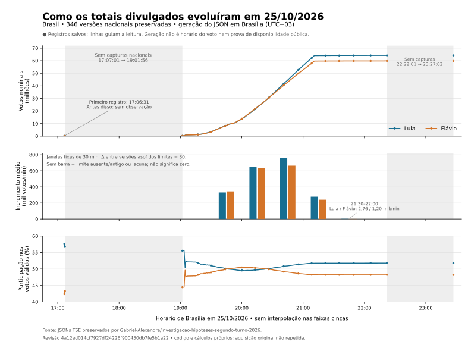
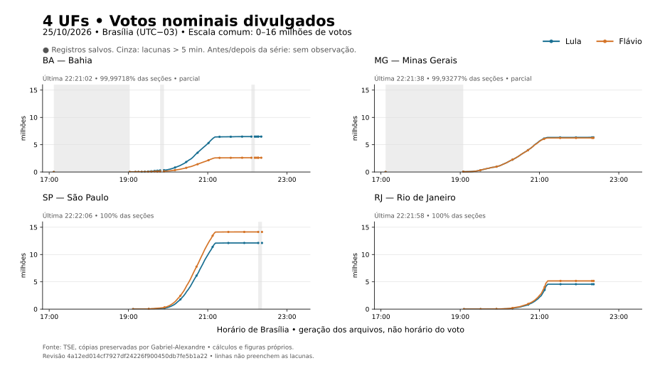
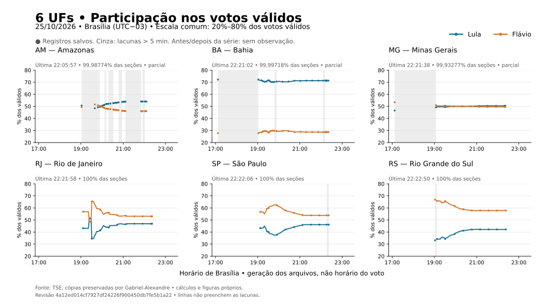

# Linha do tempo da divulgação: Lula e Flávio, 25/10/2026

**A reconstrução encontrou correspondência numérica em 16 quadros com relógio
de duas emissoras: 11 da CNN e 5 da Band.** Um quadro adicional da Band sem
relógio e quatro registros de imprensa/institucionais também coincidem com
versões preservadas. São 21 confrontos numéricos nacionais, dos quais 16 têm horário
visível na transmissão. Os quatro registros de imprensa incluem título e corpo
de uma mesma matéria, não quatro veículos independentes.

Essa conferência amplia o que conseguimos verificar. Não atribui um percentual
de verdade ao vídeo inteiro: confirma números específicos e sua exibição,
enquanto a explicação causal para os padrões exige outros testes.

A figura usa 346 versões nacionais preservadas. Os cálculos foram refeitos
com código próprio; a coleta histórica dos JSONs é atribuída ao estudo de
referência. Os 2.554 arquivos de Brasil, UFs e exterior foram comparados,
em bytes, com o manifesto e o ZIP da revisão fixada. Os
[resultados](../resultados/serie_temporal.json), o
[confronto das fontes](../resultados/confronto-divulgacao.json) e as
[instruções de reprodução](reproduzir-serie-temporal.md) ficam abertos.

## Existe uma fonte oficial além dos vídeos?

Sim: o [TSE apresenta um histórico oficial do segundo turno](https://www.tse.jus.br/comunicacao/noticias/2026/Outubro/como-a-totalizacao-dos-votos-evoluiu-ferramenta-do-tse-permite-acompanhar-o-processo), no [Painel da Evolução da Totalização](https://evolucao-totalizacao.tse.jus.br/). Nesta sessão, seu export não foi coletado: a consulta web retornou 403 e o navegador local estava desabilitado. Isso limita nossa extração, sem demonstrar ausência da base.

| Fonte oficial | O que permite examinar | Limite para esta pergunta |
| --- | --- | --- |
| Painel da Evolução da Totalização | Histórico agregado por abrangência/cargo | Export e granularidade não conferidos nesta rodada |
| [Boletins de urna](https://dadosabertos.tse.jus.br/dataset/resultados-2026-boletim-de-urna) | Resultado por seção, depois do encerramento | Catálogo informa carga única após cada turno; não é uma sequência de parciais |
| [Arquivos transmitidos](https://dadosabertos.tse.jus.br/dataset/resultados-2026-arquivos-transmitidos-para-totalizacao) | BU, log, RDV e outros arquivos | O conjunto informa somente situação Totalizado; arquivos e versões devem ser identificados |
| [Arquivos JSON de divulgação](https://www.tse.jus.br/eleicoes/informacoes-tecnicas-sobre-a-divulgacao-de-resultados) | Resultados atualizados por abrangência | O arquivo atual não comprova que guardamos todas as versões passadas |

O log cronológico registra eventos do equipamento; o boletim traz os totais da seção. Não há nesta investigação uma tabela pública de candidato escolhido por pessoa e horário individual. Associar um evento de log a uma candidatura exige evidência que esses agregados não oferecem.

Os vídeos continuam úteis para confrontar o que foi exibido e localizar falas. A documentação oficial pode ampliar a reconstrução e reduzir o trabalho visual; são camadas complementares. [Registro das fontes oficiais e do acesso](../fontes/fontes-temporais-oficiais.json).

## As duas horas e os relógios

A [Agência Brasil](https://agenciabrasil.ebc.com.br/justica/noticia/2026-10/zanin-manda-ampliar-horario-de-votacao-ate-19h)
registrou a suspensão às 17h06, com 1.225 seções e 335.743 votos válidos:
Lula 193.574, Flávio 142.169. Esses números coincidem exatamente com a versão
nacional gerada às 17h06min31s. A notícia foi publicada às 17h07 e atualizada
às 17h40; a atualização editorial não muda a hora atribuída à parcial.

Na coleção nacional há registros às 17h06min31s e 17h07min01s, seguidos por
uma lacuna até 19h01min56s. Este último JSON ainda informa totalização
às 17h07min37s. Logo, geração do arquivo e totalização são eventos distintos.
A lacuna é de 1h54min55s entre gerações salvas; não observamos uma curva
contínua nesse trecho, nem podemos chamá-lo de ganho zero.

O [TSE](https://www.tse.jus.br/comunicacao/noticias/2026/Outubro/envio-rapido-de-boletins-de-urna-garante-totalizacao-recorde-no-2o-turno)
informou retrospectivamente resultado irreversível às 21h09 e conclusão da
totalização às 23h26. O JSON final preservado tem totalização 23h26min38s e
geração 23h27min02s, com 64.256.232/59.826.041 votos. A diferença entre esses
relógios precisa ser conservada ao comparar notícias, telas e arquivos.

Assim, não reconstruímos uma velocidade das pessoas votando. Reconstruímos
incrementos dos **totais divulgados**. A pergunta sobre o efeito da prorrogação
exige ainda identificar seções que continuaram abertas, seus boletins, eventos
e horários, além de um desenho de comparação adequado.

## Conferência nas transmissões

Foram inspecionados 20 quadros amostrados de cada arquivo CNN/Band e 20 da
Jovem Pan diurna. Essa amostragem não equivale a assistir integralmente às
transmissões. Na CNN, o rodapé nacional foi separado de telões estaduais.
Na Band, os números presidenciais estão no telão; o rodapé pode mostrar
governador e não foi usado como placar nacional.

| Emissora / relógio | Lula | Flávio | Seções | Tipo |
| --- | ---: | ---: | ---: | --- |
| [CNN Brasil 19:05](https://www.youtube.com/watch?v=wwLxIO0zTP8&t=9794s) | 718.651 | 707.531 | 1,10% | Votos e percentuais |
| [CNN Brasil 19:22](https://www.youtube.com/watch?v=wwLxIO0zTP8&t=10824s) | 1.783.016 | 1.682.396 | 2,78% | Votos e percentuais |
| [CNN Brasil 19:39](https://www.youtube.com/watch?v=wwLxIO0zTP8&t=11855s) | 6.567.952 | 6.449.165 | 10,40% | Votos e percentuais |
| [CNN Brasil 19:56](https://www.youtube.com/watch?v=wwLxIO0zTP8&t=12886s) | 12.067.480 | 12.278.121 | 19,62% | Votos e percentuais |
| [CNN Brasil 20:14](https://www.youtube.com/watch?v=wwLxIO0zTP8&t=13917s) | 21.756.615 | 22.018.541 | 35,52% | Votos e percentuais |
| [CNN Brasil 20:31](https://www.youtube.com/watch?v=wwLxIO0zTP8&t=14948s) | 33.756.075 | 33.337.283 | 54,40% | Votos e percentuais |
| [CNN Brasil 20:48](https://www.youtube.com/watch?v=wwLxIO0zTP8&t=15979s) | 47.205.970 | 45.213.739 | 74,82% | Votos e percentuais |
| [CNN Brasil 21:05](https://www.youtube.com/watch?v=wwLxIO0zTP8&t=17010s) | 59.556.789 | 55.699.832 | 93,15% | Votos e percentuais |
| [CNN Brasil 21:22](https://www.youtube.com/watch?v=wwLxIO0zTP8&t=18041s) | 64.124.287 | 59.761.526 | 99,84% | Votos e percentuais |
| [CNN Brasil 21:40](https://www.youtube.com/watch?v=wwLxIO0zTP8&t=19072s) | 64.174.591 | 59.791.534 | 99,90% | Votos e percentuais |
| [CNN Brasil 21:57](https://www.youtube.com/watch?v=wwLxIO0zTP8&t=20103s) | 64.235.635 | 59.815.984 | 99,97% | Votos e percentuais |
| [BandNews TV 19:13](https://www.youtube.com/watch?v=y1DWEywGD2k&t=9835s) | 52,12% | 47,88% | 1,67% | Percentuais |
| [BandNews TV 19:27](https://www.youtube.com/watch?v=y1DWEywGD2k&t=10690s) | 51,26% | 48,74% | 4,10% | Percentuais |
| [BandNews TV 19:41](https://www.youtube.com/watch?v=y1DWEywGD2k&t=11545s) | 50,36% | 49,64% | 11,66% | Percentuais |
| [BandNews TV 20:10](https://www.youtube.com/watch?v=y1DWEywGD2k&t=13256s) | 49,56% | 50,44% | 30,82% | Percentuais |
| [BandNews TV 20:24](https://www.youtube.com/watch?v=y1DWEywGD2k&t=14111s) | 49,97% | 50,03% | 46,03% | Percentuais |

As 11 observações da CNN coincidem em votos nominais, percentuais de cada
candidato e percentual de seções. As 5 observações temporais da Band coincidem
nos três percentuais disponíveis. A Band não imprime votos absolutos nesses
quadros: eles permanecem `null`. Um sexto quadro legível da Band, sem relógio,
confere numericamente, mas fica fora dos 16 pontos temporais.

Exemplo: a [CNN às 19h22](https://www.youtube.com/watch?v=wwLxIO0zTP8&t=10824s)
mostra 1.783.016/1.682.396 votos e 2,78% das seções, correspondendo à versão
`3959817`, gerada às 19h21min46s. Como o relógio só imprime horas e minutos,
a diferença possível entre exibição e geração vai de 14 a 73 segundos; não
medimos um atraso exato de 14 segundos.

CNN e Band podem consumir o mesmo feed do TSE. Sua concordância corrobora a
exibição daqueles números, sem constituir duas novas totalizações independentes.
Os [localizadores, leituras e hashes](../fontes/observacoes-divulgacao.json)
permitem conferir os trechos. Recortes, filmes e transcrições integrais ficam
fora do Git; uma fonte pública não licencia automaticamente sua republicação.

Além dos 16 quadros nacionais com relógio, foi lido um telão presidencial de **Minas Gerais, CNN 19h22: Lula 140.496/Flávio 142.697,49,61%/50,39%,1,87% da apuração estadual**. A combinação não está nas versõesMG salvas: as vizinhas são 19:20:05 e 19:23:45. O confronto documenta **sem correspondência nesta coleção**, sem classificá-la como falsidade. Portanto, o conjunto completo reúne 22 observações,21 correspondências nacionais e 1 caso estadual aberto. O quadro estadual e o nacional às 19h22 compartilham o mesmo frame, não são duas cenas independentes.

## Quando muda a liderança observada

Entre versões nacionais consecutivas:

| Mudança | Última geração com liderança anterior | Primeira geração com nova liderança |
| --- | --- | --- |
| Lula → Flávio | 19:44:21 | 19:44:50 |
| Flávio → Lula | 20:23:49 | 20:24:19 |

São limites entre observações salvas, não o segundo exato de um cruzamento
contínuo. A [Reuters/UOL](https://noticias.uol.com.br/ultimas-noticias/reuters/2026/10/25/flavio-ultrapassa-lula-e-tem-5003-contra-4997-com-1398-das-secoes-apuradas-mostra-tse.htm)
publicou a liderança de Flávio às 19h56. O título traz 50,03%/49,97%, com 13,98%
das seções; o corpo traz 50,08%/49,92%, com 15,06%. Ambas as combinações
encontram correspondência, respectivamente nas gerações 19h45min30s e
19h47min21s. Não é necessário escolher uma e apagar a outra, nem chamar
19h56 de horário exato da parcial.

## Crescimento por trecho

Para cada par de gerações: `taxa = Δvotos / Δminutos`. A unidade é votos
divulgados por minuto, uma taxa média do intervalo. O ângulo geométrico muda
ao alterar a escala do gráfico; não é uma propriedade eleitoral comparável.

| Gerações selecionadas | Lula: incremento | Flávio: incremento | Lula: votos/min | Flávio: votos/min |
| --- | ---: | ---: | ---: | ---: |
| 19:04:36 → 19:29:48 | 2.737.631 | 2.606.293 | 108.636 | 103.424 |
| 19:29:48 → 19:59:38 | 9.927.745 | 10.323.393 | 332.774 | 346.036 |
| 19:59:38 → 20:29:29 | 19.530.139 | 18.977.434 | 654.276 | 635.760 |
| 20:29:29 → 20:59:41 | 22.888.030 | 19.936.055 | 757.882 | 660.134 |
| 20:59:41 → 21:29:41 | 8.354.276 | 7.231.181 | 278.476 | 241.039 |
| 21:29:41 → 21:59:51 | 82.838 | 36.093 | 2.746 | 1.196 |
| 21:59:51 → 22:22:01 | 10.959 | 5.102 | 494 | 230 |

Entre 20h e 20h30, as gerações selecionadas distam 29,85 minutos. Lula ganha
19.530.139 votos e Flávio 18.977.434. Mesmo aumentando em quantidade, a
participação de Flávio cai de 50,4685% para 49,7715%. **Queda percentual não
é diminuição da contagem nominal.** Não houve redução nominal de nenhum dos
dois candidatos nas 346 versões nacionais, nem nas outras 28 séries preservadas.

O gráfico de barras usa janelas fixas de 30 minutos, com denominador 30.
Por isso, 20h→20h30 aparece como 651.005/632.581 votos/min no gráfico;
654.276/635.760 é a taxa pelo tempo exato entre gerações. Ambas as medidas
estão declaradas e não devem ser misturadas.

Os primeiros 10/20/30 minutos após 19h também podem ser consultados sem
antecipar versões. Cada linha usa a última geração disponível até o alvo:

| Alvo | Geração usada | Lula | Flávio |
| --- | --- | ---: | ---: |
| 19:01:56 | 19:01:56 | 271.370 | 217.312 |
| 19:10:00 | 19:09:36 | 1.055.045 | 968.381 |
| 19:20:00 | 19:19:36 | 1.495.412 | 1.408.727 |
| 19:30:00 | 19:29:48 | 3.456.282 | 3.313.824 |
| 19:40:00 | 19:39:39 | 6.859.327 | 6.746.650 |
| 19:50:00 | 19:47:59 | 9.569.996 | 9.606.771 |
| 20:00:00 | 19:59:38 | 13.384.027 | 13.637.217 |

Às 19h50, o registro usado é de 19h47min59s, 121 segundos anterior. O
[comando com alvos personalizados](reproduzir-serie-temporal.md#fonte-fixada-e-execução)
reproduz essa tabela e suas taxas, sem alterar os 15 alvos do resumo padrão.

Não desenhamos uma reta durante 17h07→19h01 nem 22h22→23h27: os registros
intermediários não estão disponíveis nesta coleção. A última captura antes
de 22h30 é de 22h22min01s; tratá-la como dado novo de 22h30 criaria uma precisão
que não temos.

## A contribuição regional

Os [programas e as instruções dos gráficos](reproduzir-graficos-uf.md) também
geram figuras individuais e separam escalas absolutas de percentuais.

É possível decompor os incrementos por região, usando a última versão de
cada UF até o alvo. Isso gera uma soma de horários diferentes; exterior fica
separado. Entre 20h e 20h30:

| Região | Lula: votos/min | Flávio: votos/min |
| --- | ---: | ---: |
| Norte | 50.278 | 51.977 |
| Nordeste | 257.669 | 117.031 |
| Centro-Oeste | 40.858 | 65.095 |
| Sudeste | 181.181 | 217.189 |
| Sul | 98.290 | 166.403 |

Aqui o denominador é 30 minutos entre alvos, não o tempo de uma única geração
nacional. O Norte tem observação antiga do AM e lacunas internas. Todas as
regiões são assíncronas, inclusive quando há 27 UFs representadas. Esses
incrementos permitem examinar como a composição regional acompanha a mudança
percentual; não identificam isoladamente por que cada boletim chegou naquele momento.

As últimas versões salvas de AM, BA, MA, MG e PA ainda são parciais. Somar
as últimas UFs e exterior deixa 6.402 votos de Lula e 3.185 de Flávio abaixo
do nacional final. A discrepância está exposta como diferença de cobertura e
horários, sem forçar fechamento ou concluir desaparecimento de votos.

## Narração como índice de busca

CNN e Band foram obtidas e transcritas integralmente pela operação nativa CVideo: **10h28min44s de VOD e 12.831 segmentos temporizados**, com faster-whisper small local, CUDA float 16. Os índices privados localizaram 32 menções à Bahia e 1.023 regionais; esses localizadores não são contagens eleitorais validadas. [Manifesto sanitizado](../fontes/transmissoes.json).

Exemplos para conferir o contexto da Bahia: [CNN, posição 14130s](https://www.youtube.com/watch?v=wwLxIO0zTP8&t=14130s), [posição 15144s](https://www.youtube.com/watch?v=wwLxIO0zTP8&t=15144s) e [posição 15605s](https://www.youtube.com/watch?v=wwLxIO0zTP8&t=15605s). A posição no VOD não foi convertida em hora civil. Não publicamos transcrição integral nem tratamos o reconhecimento automático dos números como prova.

A fala localiza um assunto e seu trecho; números reconhecidos automaticamente
precisam ser conferidos no placar ou no documento. Dizer “Bahia” não basta
para provar um total baiano, e um percentual estadual não substitui o nacional.

## O que esta rodada resolve e o que segue aberto

Conseguimos documentar parciais exibidas por duas emissoras, conferir registros
contemporâneos de imprensa, delimitar as duas mudanças de liderança salvas e
calcular incrementos nacionais e regionais. Isso sustenta mais números do
estudo original do que a primeira revisão reconhecia.

A curva, por si só, não mede votos dados nas duas horas extras. Para essa
pergunta, o próximo teste é cruzar boletins e logs das seções afetadas com a
cronologia das decisões e o envio dos boletins, incluindo cobertura, fusos,
seções já fechadas e comparação com seções equivalentes. Também continuam
pendentes a hipótese de linearidade, seus controles e a estatística específica
de 99,5% dos passos. Não convertê-las em verdade ou falsidade por inspeção visual.

O [roteiro R5](roteiro-episodio-r5.md) permanece histórico. A nova [prévia visual R6](roteiro-episodio-r6-previa.md) foi solicitada por Fábio para revisão, com voz técnica e qualidade reduzida; seu recibo de publicação será ligado ao arquivo efetivamente aprovado. Nenhum vídeo anterior foi alterado. Os dados pequenos e o método
podem compor um [pacote futuro do Pergunte Aí](pergunte-ai-handoff.md), ainda
sem ingestão automática no agente web ou WhatsApp.

Referência e agradecimento ao estudo de Gabriel Carvalho e ao
[repositório original, revisão fixada](https://github.com/Gabriel-Alexandre/investigacao-hipoteses-segundo-turno-2026/tree/4a12ed014cf7927df24226f900450db7fe5b1a22).
Seu material preservado tornou possível confrontar a cronologia com as transmissões.
