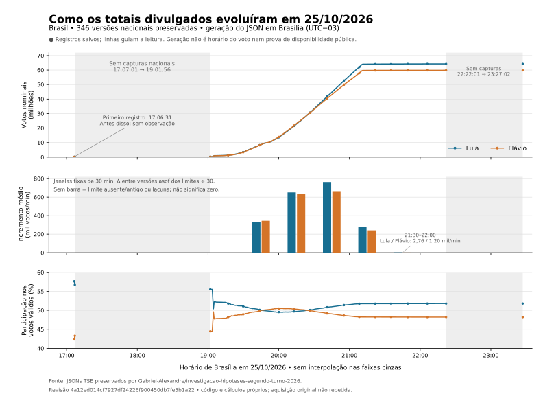

# Reproduzir a série de divulgação de 25/10/2026

O [programa próprio](../scripts/reconstruir_serie_temporal.py) reconstrói os
totais preservados pelo autor, sem importar nem executar seu código. O
[resultado pequeno](../resultados/serie_temporal.json) contém 15 horários-alvo,
as taxas nacionais e regionais, a cobertura e os hashes. A aquisição original
dos JSONs não foi repetida independentemente.

## Fonte fixada e execução

Use Python 3.12 ou posterior, somente com a biblioteca padrão. Baixe o
[ZIP da revisão 4a12ed014cf7927df24226f900450db7fe5b1a22](https://github.com/Gabriel-Alexandre/investigacao-hipoteses-segundo-turno-2026/archive/4a12ed014cf7927df24226f900450db7fe5b1a22.zip)
e preserve os arquivos extraídos sem executá-los. O SHA-256 do ZIP usado é
`f3a1378864bcc7085f24943c099afe649d7de7e8d304ffe809833936fac0a9b1`.

Nos exemplos, `local/autor/` representa a raiz extraída do projeto do autor e
`local/brutos/autor.zip` representa esse ZIP. Ambos são dados locais ignorados
pelo Git; podem estar em qualquer pasta externa ao repositório. Execute da raiz
do nosso projeto, ajustando somente os caminhos de entrada e de saída:

```text
python -s scripts/reconstruir_serie_temporal.py --captures-root local/autor/dados/copias/noite/versoes-tse --manifest local/autor/dados/copias/noite/MANIFESTO_AO_VIVO.jsonl --author-archive local/brutos/autor.zip --full-output-dir local/derivados/linha-tempo --summary-output local/serie_temporal-reproduzida.json
python -s -m unittest tests.test_serie_temporal tests.test_capturas -v
```

O script confere o hash do ZIP, cada SHA-256 e tamanho do manifesto e os bytes
de cada membro correspondente do ZIP. A execução de referência encontrou
2.554 arquivos, 2.554 entradas do manifesto e 2.554 membros correspondentes,
todos idênticos em bytes. Não foi necessária normalização CRLF/LF. Uma edição
alterada falha; não ganha silenciosamente o hash de uma versão antiga.

Os JSONs derivados próprios são gravados em UTF-8 com quebras LF explícitas,
inclusive no Windows. Seus hashes não dependem da tradução automática de
quebras de linha do sistema operacional. O SVG próprio segue a mesma regra.
Isso não normaliza, regrava nem altera os bytes das fontes brutas: seus hashes
continuam conferidos exatamente como preservados no ZIP e no manifesto.

O diretório de derivados recebe `series-completas.json`, com as 29 séries
(Brasil, 27 UFs e exterior), e `intervalos-nacionais.json`, com os 345 pares
nacionais consecutivos. O resumo registra nomes, tamanhos e hashes desses
derivados. As séries completas e fontes brutas ficam fora do Git público.
A execução lê as fontes, escreve somente nas saídas declaradas, não faz rede,
não chama modelos e não altera as fontes.

Para examinar os primeiros 10, 20, 30, 40 e 50 minutos após as 19h, mais uma
âncora inicial e o limite de 20h, use `--targets` e uma saída alternativa
ignorada pelo Git. Os horários devem ser únicos e crescentes, em `HH:mm:ss`:

```text
python -s scripts/reconstruir_serie_temporal.py --captures-root local/autor/dados/copias/noite/versoes-tse --manifest local/autor/dados/copias/noite/MANIFESTO_AO_VIVO.jsonl --author-archive local/brutos/autor.zip --full-output-dir local/derivados/primeira-hora --summary-output local/serie-temporal-primeira-hora.json --targets 19:01:56 19:10:00 19:20:00 19:30:00 19:40:00 19:50:00 20:00:00
```

As seleções personalizadas usam a mesma regra asof e expõem atraso, ausência e
lacunas; não antecipam atualizações para coincidir com o horário redondo.
Omitir `--targets` mantém exatamente os 15 alvos padrão. Gerar o relatório
alternativo não requer substituir o resumo ou a figura já entregues.

## Relógios e ausência de observação

Cada ponto conserva `dg`, `hg`, `dt`, `ht`, `idg` e `lido_em`. `generatedAt`
é `dg/hg` interpretado como horário de Brasília, `America/Sao_Paulo`, UTC-03
em 25/10/2026. Os campos originais não codificam esse fuso: a interpretação é
declarada, não apresentada como um offset fornecido pelo TSE. O offset fixo
é restrito à data examinada; não implementa regras históricas de horário de verão.

`lido_em` já tem offset e vira também `capturedAt`. Geração, totalização e
captura continuam separados. O relógio nacional `dt/ht` recebe a hipótese
Brasília explicitamente. Para UFs, o fuso de `dt/ht` não foi estabelecido:
`totalizedLocalClock` preserva seu valor sem atribuir um instante falso e
`totalizedAtBrasilia` permanece `null`. Esses campos não são usados no eixo
das taxas. Por exemplo, o JSON nacional gerado às 19:01:56 ainda contém
totalização `17:07:37`; tratá-los como o mesmo relógio perderia informação.

Cada âncora escolhe a última geração **menor ou igual** ao horário-alvo.
Às 16h e às 17h não há observação nacional preservada; o resultado é `null`.
Às 18h, o último registro continua sendo o de 17:07:01, com atraso de
3.179 segundos. Isso não demonstra que a contagem real parou ou que o ganho
de votos foi zero. Documentos históricos anteriores à noite ou com andamento
`n` são preservados na série completa e excluídos das âncoras analíticas.

A primeira versão nacional tem geração 17:06:31 e captura 17:20:42.
`latestActuallyCapturedNational` oferece também o último registro capturado
até o alvo. Portanto, a seleção por geração não afirma que um espectador já
tinha acesso àquele número no instante impresso no JSON.

Há uma inconsistência cronológica preservada: exterior (`zz`), `idg=4242891`,
tem geração 23:26:57 e `lido_em=2026-10-25T22:23:09-03:00`, diferença de
−3.828 segundos. Os bytes coincidem com manifesto e ZIP; os relógios não foram
consertados por inferência. `clockDiagnostics` explicita o conflito. Um registro
cuja captura antecede a geração é excluído da seleção por captura, pois não
comprova disponibilidade naquele horário. A seleção por geração continua sendo
uma leitura atribuída do campo original. Não há caso equivalente no nacional.

## Contagens e taxas

`votes` contém votos nominais; `shareValidPercent` é a participação nos votos
válidos observados; `sections.countedPercent` é o percentual de seções
totalizadas. São denominadores diferentes. O programa valida a soma de todos
os candidatos contra `v.vv` e não transforma candidato ausente em zero.

Para dois registros observados, calcula:

```text
Δvotos = votos_atual - votos_anterior
Δminutos = (geração_atual - geração_anterior) / 60
votosPorMinuto = Δvotos / Δminutos
pontosPercentuaisPorMinuto = (participação_atual - participação_anterior) / Δminutos
```

São taxas médias de incremento dos totais divulgados entre registros
preservados. Não são a velocidade das pessoas votando nem uma derivada contínua
conhecida. O ângulo geométrico de uma curva muda conforme a escala e a proporção
do gráfico; votos por minuto é a comparação reproduzível.

Há duas lacunas nacionais acima do limiar declarado de cinco minutos:
17:07:01 → 19:01:56, de **6.895 segundos**, e 22:22:01 → 23:27:02, de
**3.901 segundos**. Janelas que atravessam essas lacunas recebem
`notContinuous: true`. A média entre extremidades pode ser calculada, mas
não preenche o intervalo com uma reta ou demonstra crescimento constante.
Repetir a mesma versão em duas âncoras gera `no_new_observation` e taxa `null`.
O limiar operacional é configurável por `--max-gap-seconds`; não é um gate
de integridade do sistema eleitoral.

Alguns pontos do resultado, em horário de Brasília:

| Alvo | Geração efetivamente usada | Lula | Flávio | Observação |
| --- | --- | ---: | ---: | --- |
| 17:00:00 | — | — | — | Sem observação |
| 17:06:31 | 17:06:31 | 193.574 | 142.169 | Primeira versão salva |
| 17:07:01 | 17:07:01 | 221.227 | 168.920 | Antes da lacuna |
| 18:00:00 | 17:07:01 | 221.227 | 168.920 | Amostra antiga, não ganho zero |
| 19:01:56 | 19:01:56 | 271.370 | 217.312 | Após lacuna de 6.895 s |
| 19:04:36 | 19:04:36 | 718.651 | 707.531 | Nova versão |
| 19:30:00 | 19:29:48 | 3.456.282 | 3.313.824 | Atraso de 12 s |
| 20:00:00 | 19:59:38 | 13.384.027 | 13.637.217 | Atraso de 22 s |
| 20:30:00 | 20:29:29 | 32.914.166 | 32.614.651 | Atraso de 31 s |
| 21:00:00 | 20:59:41 | 55.802.196 | 52.550.706 | Atraso de 19 s |
| 21:30:00 | 21:29:41 | 64.156.472 | 59.781.887 | Atraso de 19 s |
| 22:00:00 | 21:59:51 | 64.239.310 | 59.817.980 | Atraso de 9 s |
| 22:30:00 | 22:22:01 | 64.250.269 | 59.823.082 | Amostra antiga, 479 s |
| 23:27:02 | 23:27:02 | 64.256.232 | 59.826.041 | Final nacional, 100% das seções |

Entre as âncoras de 20h e 20h30, as gerações selecionadas distam 29,85 minutos:
Lula ganha 19.530.139 votos, média de **654.276 votos/min**, e Flávio ganha
18.977.434 votos, média de **635.760 votos/min**. A participação de Flávio
cai de 50,4685% para 49,7715%, apesar do aumento nominal. Queda de participação
não é retirada de votos.

## Comparações regionais

As cinco regiões usam as divisões usuais de UFs, com o DF no Centro-Oeste e
exterior separado. Em cada alvo, cada UF fornece sua própria última geração
observada. O resumo informa quantidade esperada/observada, UFs ausentes,
UFs antigas, menor e maior horário de geração, idade máxima e hash do conjunto
de versões selecionadas. Registra também UFs cuja captura ocorreu após o alvo.
Uma soma de cobertura incompleta é parcial e nunca recebe taxa ao mudar para
cobertura completa.

As taxas regionais usam o tempo entre os alvos e são rotuladas
`asynchronous_asof_sum`: medem a variação da soma de versões de horários
diferentes. Atraso em qualquer extremidade ou lacuna interna de uma UF gera
`notContinuous`. Não equivalem à velocidade de apuração de um conjunto síncrono.
`nationalComparator` mostra a diferença entre a soma dessas UFs mais exterior
e o nacional, sem forçar fechamento nem chamar a diferença de votos ausentes.

Exemplo entre 20h e 20h30, com cobertura completa nas duas extremidades:

| Região | Lula, votos/min | Flávio, votos/min | Limite observado |
| --- | ---: | ---: | --- |
| Norte | 50.278 | 51.977 | AM antiga e lacunas; `notContinuous` |
| Nordeste | 257.669 | 117.031 | UFs assíncronas |
| Centro-Oeste | 40.858 | 65.095 | UFs assíncronas |
| Sudeste | 181.181 | 217.189 | UFs assíncronas |
| Sul | 98.290 | 166.403 | UFs assíncronas |

A série nacional contém 346 versões e nenhuma queda nominal observada para
os dois candidatos. O mesmo controle nas demais 28 séries também não encontra
queda nominal. Esse resultado descreve os arquivos salvos, sem provar o que
ocorreu entre eles nem constituir auditoria de integridade eleitoral.

O último nacional tem 499.248/499.248 seções totalizadas. Os últimos registros
salvos de AM, BA, MA, MG e PA ainda são parciais: aproximadamente 99,98774%,
99,99718%, 99,98342%, 99,93277% e 99,98560%, respectivamente. Não são rotulados
como finais a 100%. Na última âncora, a soma das versões de UFs mais exterior
fica 6.402 votos de Lula e 3.185 de Flávio abaixo do nacional; a comparação
continua qualificada por horários distintos e capturas parciais.

O confronto com jornal ou TV deve identificar também o horário do programa,
o instante da captura do quadro e eventual atraso de exibição. Um placar na
tela não deve ser convertido automaticamente em horário de voto, geração ou
totalização. A obtenção e avaliação estão documentadas no
[relatório temporal](linha-do-tempo-divulgacao.md), com16 pontos de duas emissoras.

## Reproduzir o confronto com TV e imprensa

As [leituras documentadas](../fontes/observacoes-divulgacao.json) são entradas
manuais conferidas nos quadros e nas publicações citadas. O programa compara
contagens inteiras exatamente e percentuais arredondados a duas casas com
`ROUND_HALF_UP`. Também verifica contagens de seções quando fornecidas.
Percentual de votos e percentual de seções têm denominadores distintos.

```text
python -s scripts/confrontar_observacoes.py --series local/derivados/linha-tempo/series-completas.json --summary resultados/serie_temporal.json --observations fontes/observacoes-divulgacao.json > local/confronto-reproduzido.json
python -s -m unittest tests.test_observacoes -v
```

O SHA-256 da série deve coincidir com o declarado no resumo. A execução
encontra 21 correspondências nacionais,16 delas com relógio visível. A leitura
adicional de MG não encontra correspondência nas versões preservadas. São 22
observações e 17 leituras com relógio, em 16 quadros distintos: um mesmo quadro
CNN contém o nacional e MG. Um ponto da
Band sem relógio confere apenas números; imprensa com horário de publicação
não recebe hora de tela. Versões diferentes com os mesmos números continuam
ambíguas. Ausência de correspondência não produz automaticamente “falso”.
O resultado também delimita mudanças de liderança entre gerações consecutivas;
não interpola o instante do cruzamento. Os hashes de entradas JSON próprias
usam bytes canônicos do Git, com LF; cópias de trabalho com CRLF devem ser
normalizadas para LF antes de comparar os hashes desses artefatos próprios.
Essa orientação não permite alterar os bytes das fontes brutas, verificados
contra o ZIP e o manifesto originais.

## Figura quantitativa opcional



O [gerador da figura](../scripts/plotar_serie_temporal.py) usa Matplotlib
opcional, se já instalado. Não instala bibliotecas. Confere o SHA-256 da série
completa contra o resumo antes de desenhar os três painéis. Para reproduzir:

```text
python -s scripts/plotar_serie_temporal.py --series local/derivados/linha-tempo/series-completas.json --summary resultados/serie_temporal.json --svg local/curva-divulgacao.svg --png local/derivados/linha-tempo/curva-divulgacao.png
```

Os painéis mostram votos nominais em milhões, incrementos médios em mil
votos/minuto e participação nos válidos em percentual. Compartilham um eixo
horário real, sem ligar as duas lacunas nacionais; antes da primeira versão
não existe curva. O SVG é vetorial e os marcadores indicam registros salvos,
sem alegar observação contínua.

**O denominador do painel de taxas é fixo:** versões asof das extremidades
de janelas de 30 minutos, com o incremento dividido por 30. Essa escolha
permite comparar janelas iguais. Difere das taxas do JSON principal, cujo
denominador é o tempo exato entre gerações selecionadas. Por exemplo,
20h→20h30 tem 651.005/632.581 votos por minuto no gráfico para Lula/Flávio,
contra 654.276/635.760 ao dividir pelos 29,85 minutos entre gerações.
Ambas as definições estão explícitas; não devem ser misturadas.

Somente cinco janelas completas, sem lacuna e com extremidades até cinco
minutos antigas, recebem barras. Janela com observação ausente, antiga ou
com lacuna fica sem barra e não representa taxa zero. O último par pequeno
21h30→22h é anotado para permanecer legível na mesma escala. Um manifesto
diagnóstico ao lado do PNG registra todas as janelas, exclusões e hashes.
